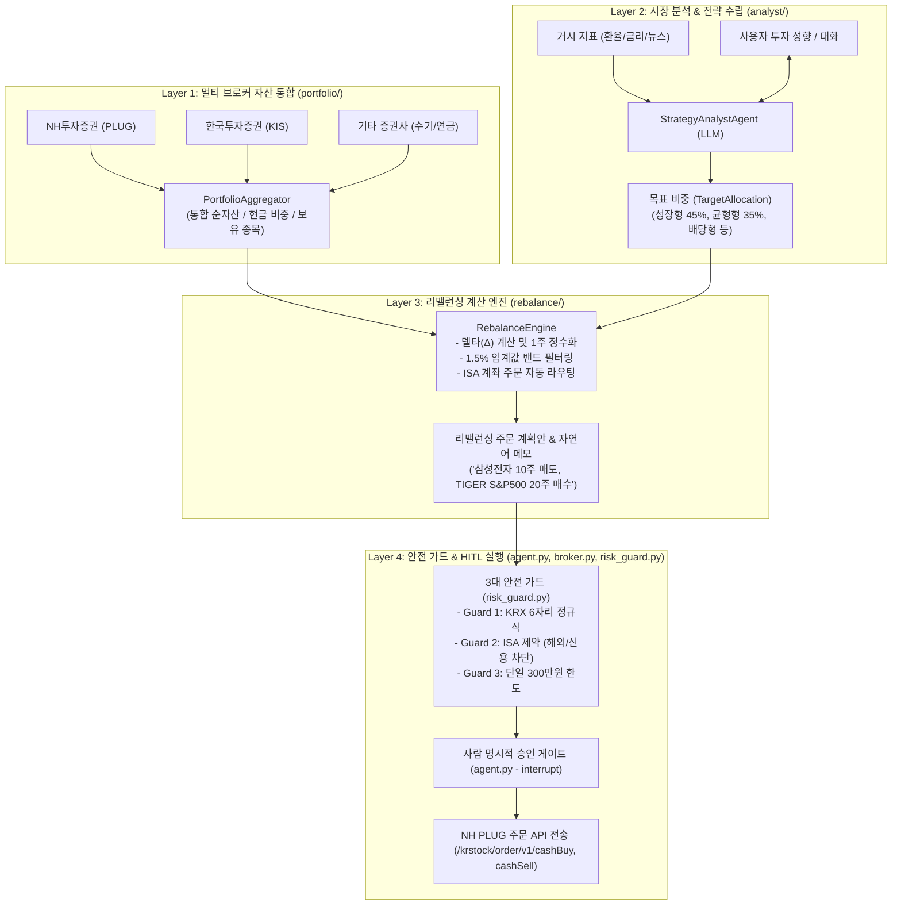

# NH투자증권 나무 PLUG API 기반 자산관리 & ISA 주식 매매 Agent

> **"LLM은 시장 분석과 전략 제안만 수행하며, 주문 실행은 엄격한 Rule-based 리스크 가드와 명시적 Human Approval(HITL) 후에만 실행된다."**

본 프로젝트는 **멀티 증권사 통합 자산 조회(Layer 1)**, **시장 분석 및 대화형 전략 수립(Layer 2)**, **포트폴리오 리밸런싱 델타 계산(Layer 3)**, **중개형 ISA 3대 안전 가드 및 HITL 주문 실행(Layer 4)**을 유기적으로 결합한 **자율형 자산관리 & 매매 보조 풀스택 시스템**입니다.

---

## 🏛 4-Layer 멀티 에이전트 아키텍처



---

## 💻 듀얼 프론트엔드 (Dual Frontends)

사용 목적에 따라 2가지 인터페이스를 제공합니다:

1. **대화형 CLI & Antigravity 네이티브 콘솔 (`main.py`)**:
   - 터미널이나 Antigravity 채팅창에서 자연어로 전략을 논의하고, 실시간으로 리밸런싱 주문을 확인 및 승인(`y/n`).
2. **브라우저 웹 대시보드 (`streamlit_app.py`)**:
   - `streamlit run streamlit_app.py`
   - 한눈에 보는 통합 자산 파이차트, 평가손익, 전략 프리셋 선택, 1주 단위 리밸런싱 주문표 및 원클릭 승인 버튼 제공.

---

## 📂 파일 및 패키지 구조

```text
valiant-carson/
├── portfolio/                 # [Layer 1] 멀티 브로커 자산 통합
│   ├── models.py              # Position, AccountBalance, UnifiedPortfolio
│   ├── broker_adapters.py     # NH투자증권(PLUG), 한투(KIS), 수기 입력 어댑터
│   └── aggregator.py          # 멀티 계좌 잔고 수집 및 표준화 집계기
├── analyst/                   # [Layer 2] 마켓 분석 & 전략 대화 에이전트
│   ├── models.py              # MarketOverview, TargetAllocation
│   ├── market_feed.py         # 거시경제(환율/금리/뉴스) 피더
│   └── strategy_agent.py      # LLM 기반 포트폴리오 목표 배분 전략가
├── rebalance/                 # [Layer 3] 포트폴리오 리밸런싱 엔진
│   ├── models.py              # OrderProposal, RebalancePlan
│   └── engine.py              # 델타 계산, 1주 정수화, 매도 우선 정렬, 자연어 메모 생성
├── risk_guard.py              # [Layer 4] 3대 안전 가드 (KRX 티커, ISA 제약, 300만원 한도)
├── broker.py                  # [Layer 4] NH투자증권 PLUG 주문 전송 격리 레이어
├── agent.py                   # [Layer 4] LangGraph MemorySaver 기반 HITL 파이프라인
├── orchestrator.py            # Layer 1~4 전체 파이프라인 총괄 오케스트레이터
├── streamlit_app.py           # 브라우저 웹 대시보드
├── main.py                    # 대화형 CLI 엔트리포인트
├── tests/                     # 단위 및 통합 테스트 스위트 (14개 테스트 100% 통과)
└── ROADMAP.md                 # 아키텍처 상세 설계서 및 마일스톤
```

---

## 🚀 빠른 시작 가이드

### 1. 패키지 설치
```bash
pip install -r requirements.txt
```

### 2. 환경변수 설정 (`.env`)
```bash
cp .env.example .env
```
필요에 따라 본인의 `OPENAI_API_KEY`, `NHPLUG_APP_KEY`, `NHPLUG_APP_SECRET`, `NH_ISA_ACCOUNT_NO`를 입력합니다. (키가 없거나 테스트 시에는 자동으로 실감나는 `DRY_RUN` 모의 체결 모드가 작동합니다.)

### 3. 실행 방법

#### 방법 A: 전체 통합 자산 조회 및 자동 리밸런싱 실행
```bash
python main.py
```
콘솔 메뉴에서 `1`을 선택하면 내 전체 자산 현황을 조회하고, 전략을 선택하여 리밸런싱 주문을 산출한 뒤 승인을 거쳐 전송합니다.

#### 방법 B: Streamlit 웹 대시보드 실행
```bash
streamlit run streamlit_app.py
```
브라우저에서 통합 자산 비중 그래프, 전략 선택, 리밸런싱 주문표를 확인하고 원클릭으로 승인할 수 있습니다.

#### 방법 C: 단위 및 전체 통합 테스트 실행
```bash
python -m pytest tests/
```
(14개 테스트 케이스: 어댑터, 집계기, 델타 계산기, 3대 가드, HITL 게이트, E2E 전체 플로우 전체 통과)
