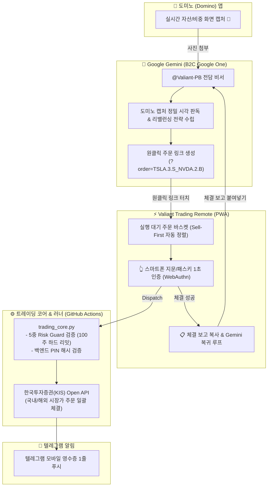

# VALIANT ASSETS: 초경량 Web-Direct 트레이딩 리모컨 & Closed-Loop 시스템

> **"유료 API 비용 0원(Google One AI Premium B2C 활용), 도미노(Domino) 멀티모달 분석, 그리고 1초 지문(패스키) 터치로 완성되는 Sell-First 리밸런싱 트레이딩 리모컨"**

본 프로젝트는 개인 투자자의 실자산 포트폴리오를 관리하고 리밸런싱하기 위해 구축된 **초경량 Web-Direct Closed-Loop 트레이딩 리모컨 시스템**입니다.

---

## 🏛 시스템 아키텍처 (Closed-Loop)

---

## 🌟 핵심 특징

1. **초경량 1초 체결 리모컨 (Zero Bloat)**:
   * 무거운 차트 라이브러리 및 불필요한 과거 스냅샷 탭을 완전히 걷어내고, 오직 **주문 확인 및 1초 지문 체결**에만 집중된 극강의 가벼움(0.1초 로딩).
2. **도미노(Domino) 캡처 기반 Gemini 전담 PB**:
   * 증권사 단일 계좌를 넘어, 전체 실자산이 모여있는 도미노 앱 화면을 Gemini가 시각(Vision) 판독하여 최적의 리밸런싱 수량과 체결 링크를 생성.
3. **W3C WebAuthn 생체인증 (지문 / 패스키 Passkey)**:
   * 6자리 PIN을 일일이 칠 필요 없이, 스마트폰 지문 센서 터치 1회로 주문 승인 (미지원 기기는 6자리 PIN으로 자동 폴백).
4. **체결 후 Gemini 피드백 루프 (Closed-Loop)**:
   * 체결 완료 즉시 `[📋 체결 결과 복사 & Gemini에 보고하기 ↗]` 원클릭 버튼 제공으로 Gemini 전담 비서에게 최신 상태를 즉시 동기화.
5. **5중 안전 가드레일 (Safety Guards)**:
   * 1회 최대 100주 / 10종목 하드 리밋.
   * Sell-First (매도 선실행 ➔ 예수금 확보 ➔ 매수) 파이프라인.
   * 주문 간 0.5초 Rate Limit.
   * 백엔드 SHA-256 PIN 해시 검증 (공개 저장소 Zero-Trust).
   * 텔레그램 체결 영수증 실시간 알림.
