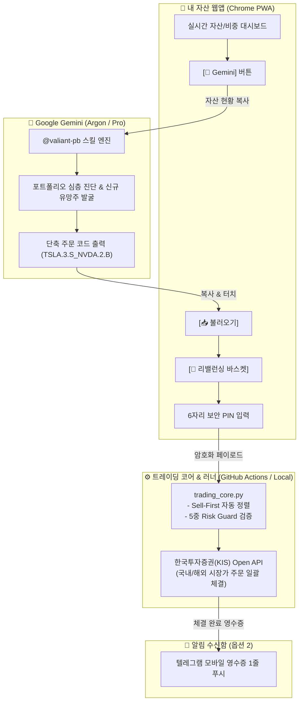

# VALIANT ASSETS: Web-Direct Closed-Loop 트레이딩 시스템

> **"유료 API 비용 0원(Google One AI Premium B2C 활용), 5중 보안 가드레일, 그리고 1회 6자리 PIN으로 완성되는 Sell-First 리밸런싱 트레이딩 관제탑"**

본 프로젝트는 개인 투자자의 실자산 포트폴리오를 관리하고 리밸런싱하기 위해 구축된 **Web-Direct Closed-Loop 자산관리 & 매매 자동화 시스템**입니다.

---

## 🏛 시스템 아키텍처 (Closed-Loop)



---

## 🌟 핵심 특징

1. **유료 종량제 API 비용 0원 (B2C 구독 100% 활용)**:
   - 개발자용 유료 API 호출 대신 이미 구독 중인 **Google One AI Premium (Gemini Advanced/Pro, Argon 모델)** 웹/앱을 그대로 활용합니다.
2. **Gemini Skill `@valiant-pb` 탑재**:
   - 대화가 100턴 이어져도 포트폴리오 관리 원칙, 신규 종목 탐색, Sell-First 바스켓 주문 포맷을 잊지 않고 영구 보존합니다.
3. **Sell-First 복합 리밸런싱 바스켓 (1-PIN 체결)**:
   - 매도(SELL) 주문으로 예수금을 먼저 확보한 후 매수(BUY)가 순차 체결되는 파이프라인.
   - 단 1회의 6자리 PIN 입력으로 최대 10종목을 일괄 전송.
4. **모바일 퍼스트 UX (가로 스크롤 0%)**:
   - 3열 콤팩트 카드 뷰 및 5-Tab 하단 고정 바(`[비중] [추이] [📥불러오기] [🛒바스켓] [🧠Gemini]`).
5. **텔레그램 체결 영수증 1줄 푸시 (옵션 2)**:
   - 복잡한 챗봇 대화 대신 증권사 체결 결과 영수증 수신함으로 운영하여 피로도 최소화.

---

## 🛡️ 5중 보안 가드레일 (Total 5-Layer Defense)

1. **Human-in-the-Loop (원천 사고 차단)**: AI는 분석과 제안만 수행하며, 사용자가 웹앱에서 직접 6자리 PIN을 누르지 않으면 증권사 주문 0건도 나가지 않습니다.
2. **2차 보안 PIN 인증**: 6자리 마스터 PIN 없이는 주문 체결 불가.
3. **100주 하드 리밋 (Risk Guard)**: 종목당 1회 최대 주문 수량은 100주 이하로 엔진 레벨에서 강제 제한.
4. **호출 제한(Rate Limit) 방어**: 복합 주문 집행 시 종목 간 0.5초 강제 딜레이 부여.
5. **화이트리스트 통제**: 등록된 단 1명의 Telegram User ID 및 GitHub 저장소만 허용.

---

## 📂 프로젝트 구조

```text
valiant-carson/
├── index.html                 # 모바일 반응형 웹앱 (PWA 대시보드 & 바스켓)
├── core/
│   ├── trading_core.py        # 단일 트레이딩 코어 (바스켓 파서 & KIS 클라이언트)
│   └── crypto_vault.py        # AES-256 로컬 암호화 모듈
├── scripts/
│   └── telegram_bot.py        # 텔레그램 체결 알림 푸시 봇
├── docs/
│   ├── SETUP_GUIDE.md         # KIS API 및 텔레그램 세팅 종합 가이드
│   ├── BATCH_TRADING_SPEC.md  # 복합 리밸런싱 바스켓 기술 명세서
│   └── TELEGRAM_TRADING_GUIDE.md # 텔레그램 영수증 알림 가이드
└── tests/
    ├── test_trading_core.py   # 코어 엔진 단위 테스트
    └── test_telegram_trading.py # 텔레그램 및 E2E 테스트 (40개 ALL PASS)
```

---

## 🚀 빠른 설정 및 시작

자세한 설정 방법은 [SETUP_GUIDE.md](docs/SETUP_GUIDE.md)를 참고하세요:
1. **한국투자증권(KIS) Open API**: [KIS Developers](https://apiportal.koreainvestment.com/)에서 AppKey/AppSecret 발급
2. **텔레그램 알림 봇**: `@BotFather`에서 봇 생성 및 `@userinfobot`으로 내 ID 확인
3. **무결성 검증**:
   ```bash
   python -m unittest tests/test_trading_core.py tests/test_telegram_trading.py -v
   ```
