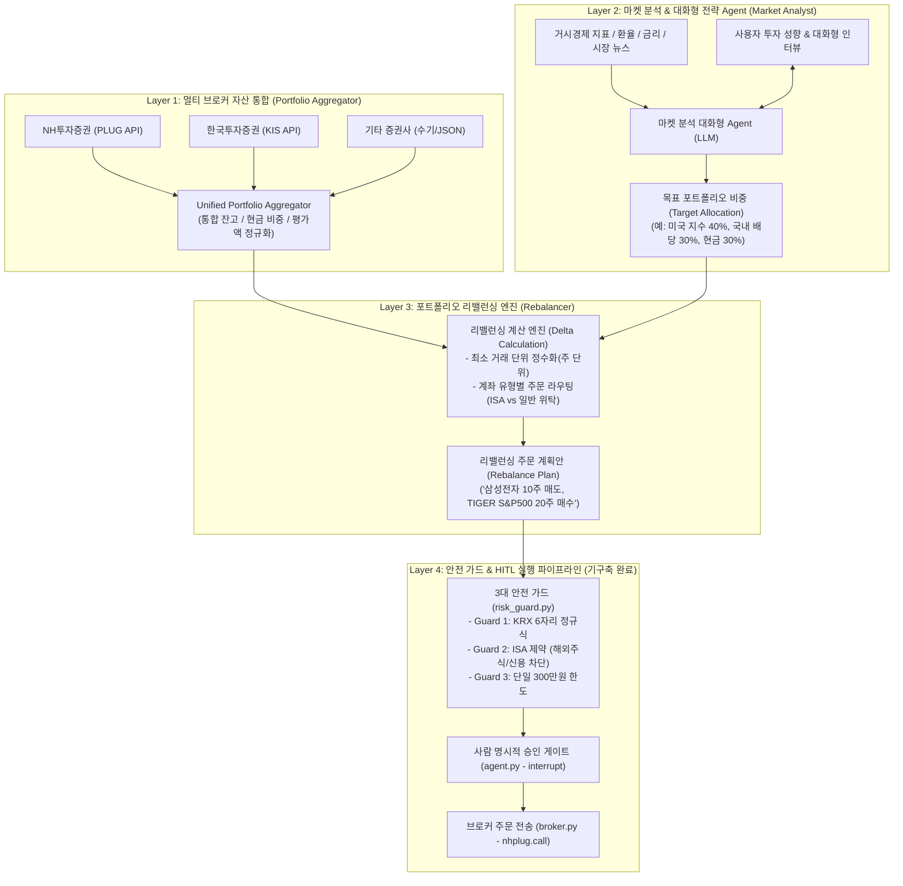

# 🗺️ Multi-Agent 자산관리 및 자동 리밸런싱 시스템 로드맵 & 레이어별 상세 설계

> **작업 디렉토리**: `c:\Users\wylee\Documents\antigravity\valiant-carson`  
> **프로젝트 코드명**: `valiant-carson` (Autonomous Wealth Management & Safe Execution Pipeline)

---

## 1. 전체 아키텍처 개요 (4-Layer Multi-Agent Architecture)



---

## 2. Layer별 상세 설계 명세

### 층위 1: Multi-Broker Portfolio Aggregation Layer (Layer 1)

#### 1. 목적 및 역할
* 흩어져 있는 복수 증권사(NH투자증권, 한국투자증권, 키움증권 등)의 계좌를 연결하여 **실시간 총 순자산가치(NAV), 현금 비중, 종목별 평가금액/수량**을 단일 스키마로 표준화.

#### 2. 핵심 인터페이스 및 데이터 모델
* **`BaseBrokerAdapter` (추상 인터페이스)**:
  ```python
  class BaseBrokerAdapter(ABC):
      @abstractmethod
      def get_cash_balance(self) -> int:
          """예수금(출금가능금액/D+2) 조회"""
          pass
      
      @abstractmethod
      def get_positions(self) -> List[Position]:
          """보유 종목, 수량, 매입단가, 현재가, 평가금액 조회"""
          pass
  ```
* **구현 어댑터**:
  * `NHBrokerAdapter`: NH 나무 PLUG API (`/krstock/acctinfo/v1/balance`)
  * `KISBrokerAdapter`: 한국투자증권 Open API (모의/실전)
  * `ManualBrokerAdapter`: API가 없는 타 증권사용 CSV/JSON/수기 등록
* **`UnifiedPortfolioSnapshot` (통합 포트폴리오 스냅샷)**:
  * 총 평가자산 (`total_net_worth`)
  * 총 예수금 현금 및 현금 비중 (`total_cash`, `cash_ratio`)
  * 통합 보유 종목 리스트 및 자산군(Asset Class)별 비중

---

### 층위 2: Market Analysis & Conversational Strategy Agent (Layer 2)

#### 1. 목적 및 역할
* 고정된 공식에 의존하지 않고, **최신 시장 매크로 환경(금리, 환율, 주요 지표, 이벤트)과 사용자의 성향을 대화형으로 서베이**하여 현실적인 **목표 자산배분 비중(Target Allocation)**을 도출.

#### 2. 핵심 프로세스
1. **시장 데이터 수집**:
   - 코스피/코스닥 지수 현황, 환율(USD/KRW), 미국 주요 지수(S&P500, 나스닥) 동향
   - 주요 뉴스 및 금리/실적 이벤트 브리핑
2. **대화형 전략 인터뷰 (Interactive Interview)**:
   - "현재 미국 지수 ETF 비중이 70%로 높습니다. 환율이 고점인 상황에서 현금 비중을 20%로 늘리는 리밸런싱을 고려하시겠습니까?"
   - 사용자의 답변 및 피드백을 반영하여 전략 수정
3. **Target Allocation 출력 규격 (Pydantic)**:
   ```json
   {
     "strategy_name": "중립형 자산배분 2026-Q4",
     "target_cash_ratio": 0.20,
     "targets": [
       {"code": "360750", "name": "TIGER 미국S&P500", "target_weight": 0.40, "account_type": "ISA"},
       {"code": "005930", "name": "삼성전자", "target_weight": 0.20, "account_type": "ISA"},
       {"code": "CASH", "name": "원화예수금", "target_weight": 0.20, "account_type": "ISA"},
       {"code": "AAPL", "name": "Apple", "target_weight": 0.20, "account_type": "GENERAL"}
     ]
   }
   ```

---

### 층위 3: Portfolio Rebalancing Engine (Layer 3)

#### 1. 목적 및 역할
* Layer 1의 **현재 자산 스냅샷**과 Layer 2의 **목표 자산배분 모델**을 입력받아, 포트폴리오를 목표 상태로 이동시키기 위한 **최소 거래 주문 목록(Delta)**을 오차 없이 계산.

#### 2. 핵심 알고리즘 및 제약 조건
1. **수학적 델타 계산**:
   $$\text{Target Value}_i = \text{Total NAV} \times \text{Target Weight}_i$$
   $$\Delta \text{Value}_i = \text{Target Value}_i - \text{Current Value}_i$$
   $$\Delta \text{Quantity}_i = \left\lfloor \frac{\Delta \text{Value}_i}{\text{Current Price}_i} \right\rfloor$$
2. **리밸런싱 밴드 (Threshold Filter)**:
   - 비중 오차가 $\pm 2\%$ 이내인 미세한 변동은 불필요한 거래 수수료 방지를 위해 매매 제외.
3. **계좌별 라우팅 제약**:
   - 중개형 ISA 대상 종목(국내 주식/국내 상장 해외ETF) ➔ **ISA 계좌용 주문**으로 분류.
   - 해외 직투 주식(AAPL 등) ➔ **일반 해외 위탁계좌 주문**으로 분리.
4. **출력**:
   - Layer 4의 안전 파이프라인으로 전달되는 주문 리스트(또는 자연어 매매 메모 형태).

---

### 층위 4: Safe Execution & Risk Gateway (Layer 4 - 구축 완료)

#### 1. 현재 구축 상태: `valiant-carson`에 100% 가동 준비 완료
* **`risk_guard.py`**:
  * Guard 1 (티커 정규식 및 KRX 마스터 실시간 대조)
  * Guard 2 (중개형 ISA 규정: 해외주식/신용 원천 차단)
  * Guard 3 (단일 주문 300만원 한도 검증)
* **`agent.py`**: LangGraph `MemorySaver` 체크포인터 기반 `interrupt()` 승인 대기.
* **`broker.py`**: NH투자증권 나무 PLUG API (`/krstock/order/v1/cashBuy`, `cashSell`).
* **`main.py`**: 대화형 CLI 및 실시간 모니터링 인터페이스.

---

## 3. 단계별 구현 마일스톤 (Roadmap)

| 단계 | 마일스톤 | 주요 산출물 | 상태 |
| :--- | :--- | :--- | :--- |
| **Phase 1** | **안전 매매 실행 파이프라인 (Execution Engine)** | `broker.py`, `risk_guard.py`, `agent.py`, `main.py`, 3대 가드, HITL 게이트 | **완료 (테스트 100% 통과)** |
| **Phase 2** | **NH PLUG 잔고 조회 & 통합 자산 관리자 (Layer 1)** | `portfolio/aggregator.py`, NH 잔고 조회 API 연동, 포트폴리오 정규화 | **다음 착수 (Next)** |
| **Phase 3** | **포트폴리오 리밸런싱 계산 엔진 (Layer 3)** | `rebalance/engine.py`, 델타 계산기, 최소 1주 정수화, 계좌 라우터 | **예정** |
| **Phase 4** | **마켓 분석 & 대화형 전략 Agent (Layer 2)** | `analyst/market_agent.py`, 시장 지표 수집, 목표 비중 인터뷰 대화 루프 | **예정** |
| **Phase 5** | **종단간 통합 대시보드 (End-to-End Orchestration)** | 통합 CLI / Web UI, '시장 분석 ➔ 리밸런싱 ➔ 안전 승인 ➔ 자동 매매' 원클릭 파이프라인 | **최종 단계** |
